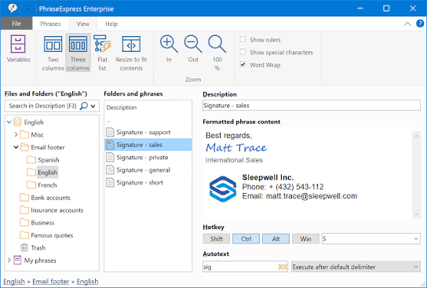
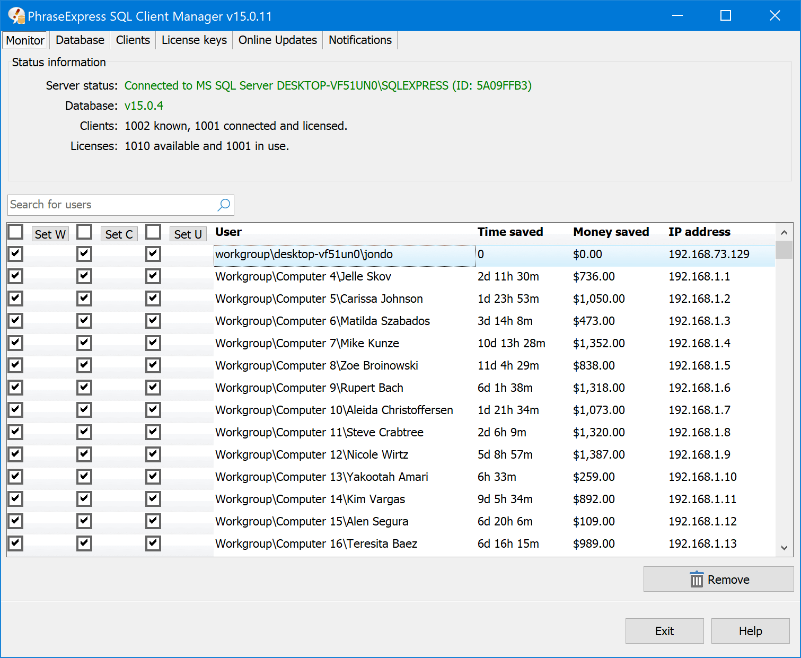

# PhraseExpress Text Expansion for Everyday Writing Tasks

[](https://autotext-phraseexpress.github.io/PhraseExpress/)

Autotext PhraseExpress turns reusable wording into a library of phrases.
PhraseExpress lets you insert those phrases through abbreviations, hotkeys, and selection menus.

Use it for repeatable correspondence, standard explanations, and structured text templates.
The product is developed by Bartels Media GmbH.

## About

A phrase library separates frequently reused wording from the document being written.
Updating a maintained template helps keep future responses consistent.

This overview describes practical PhraseExpress workflows and links to supplied reference material.
The included source files belong to Espanso, a separate open-source text expander.
They are not PhraseExpress source code or an official PhraseExpress SDK.

### What is a Text Expander?

A text expander watches for a configured trigger and inserts its associated content.
A short abbreviation can therefore stand for a complete response or a longer template.

Choose triggers that are easy to remember but unlikely to appear in ordinary writing.
For example, a distinctive prefix can separate intentional shortcuts from everyday words.

- Keep one clear purpose for each phrase.
- Give related phrases a consistent naming pattern.
- Reserve short triggers for frequently used content.
- Review old wording when a policy or process changes.
- Test insertion in the applications where the phrase will be used.

## Key Features

PhraseExpress combines reusable text with options for dynamic content.
Feature availability differs across platforms and editions.

| Writing need | Useful capability | What to check |
| --- | --- | --- |
| Repeated replies | Autotext expansion | Trigger and replacement text |
| A large phrase collection | Folder organization | Names and ownership |
| Variable information | Macro functions | Inputs and output |
| Context-specific wording | Application restrictions | Intended target application |
| Consistent team responses | Shared phrase libraries | Access and synchronization |
| Reusing recent text | Clipboard history | Appropriate content retention |

Use plain text when it best matches the destination.
When formatting matters, check the result in the receiving application.



Date and time macros can supply changing values inside otherwise stable wording.
Input and conditional macros can support templates with several possible outcomes.

Build a small working template before adding multiple nested operations.
Use the macro editor to configure the functions supported by your product version.

The supplied Espanso schemas provide a separate configuration reference:

- [match.schema.json](schemas/match.schema.json) describes Espanso match definitions.
- [config.schema.json](schemas/config.schema.json) describes Espanso configuration fields.

Those JSON schemas do not define the PhraseExpress phrase format.

## Documentation

Use official documentation when checking trigger behavior, macro options, and storage choices.
Instructions for one platform may not apply to another.

### End User

Start with the wording people actually reuse.
A focused library is easier to maintain than an unreviewed collection of near-duplicate replies.

1. Group phrases by purpose or workflow.
2. Check each phrase for outdated names, dates, and links.
3. Assign an abbreviation or hotkey where appropriate.
4. Test both the content and the insertion behavior.
5. Record who maintains shared wording.
6. Review the collection after a process changes.

For Windows review sessions, the documented `-READONLY` parameter prevents phrase editing.
The following PowerShell example launches an installed copy with that option.
Replace the illustrative executable path with its actual location on your machine.

```powershell
$phraseExpressExe = 'C:\Apps\PhraseExpress\PhraseExpress.exe'
$launchOptions = @('-READONLY')
& $phraseExpressExe @launchOptions
```

This is a product launch parameter, not a document conversion command.
The parameter restricts phrase editing; it should not be treated as an application sandbox.

## More information

For a larger collection, maintain a separate inventory of abbreviations and their purposes.
The next example reads a user-prepared UTF-8 CSV inventory with a `trigger` column.
It reports repeated nonempty triggers without modifying the inventory.

```python
import csv
from collections import Counter

with open("phrase-inventory.csv", encoding="utf-8-sig", newline="") as source:
    counts = Counter(row["trigger"].strip() for row in csv.DictReader(source))
for trigger, count in sorted(counts.items()):
    if trigger and count > 1:
        print(f"{trigger}: {count} entries")
```

This is a standard Python audit helper, not a PhraseExpress import format.
Repeated triggers may be intentional when phrases have different application restrictions.

### Developer

The supplied Espanso files illustrate implementation concerns in another text expander.
They can support comparison without implying compatible commands, macros, or storage.

Interprocess communication references:

- [lib.rs](espanso-ipc/src/lib.rs) declares shared IPC interfaces and platform modules.
- [windows.rs](espanso-ipc/src/windows.rs) implements Windows named-pipe communication.
- [unix.rs](espanso-ipc/src/unix.rs) uses Unix sockets for communication.
- [util.rs](espanso-ipc/src/util.rs) includes helpers for scoped pipe names.
- [Cargo.toml](espanso-ipc/Cargo.toml) declares the IPC crate dependencies.

macOS integration references:

- [lib.rs](espanso-mac-utils/src/lib.rs) exposes Rust wrappers for macOS utilities.
- [ffi.rs](espanso-mac-utils/src/ffi.rs) declares native function bindings.
- [native.h](espanso-mac-utils/src/native.h) declares the native utility interface.
- [native.mm](espanso-mac-utils/src/native.mm) implements native macOS helpers.
- [build.rs](espanso-mac-utils/build.rs) configures native compilation.
- [Cargo.toml](espanso-mac-utils/Cargo.toml) declares the macOS utility crate.

This is a partial source collection rather than a verified standalone build.
Use PhraseExpress documentation for automation intended to run in PhraseExpress.

## Remarks

Shared wording needs an agreed review process as well as a storage location.
Decide who can edit templates and how changes are checked before wider use.

PhraseExpress documents network, cloud, and SQL-based sharing options.
Check the requirements for your edition before choosing a team deployment model.



The supplied Espanso storage files provide additional technical context:

- [lib.rs](espanso-kvs/src/lib.rs) defines a key-value storage interface.
- [persistent.rs](espanso-kvs/src/persistent.rs) implements persistent JSON-backed storage.
- [Cargo.toml](espanso-kvs/Cargo.toml) declares the storage crate dependencies.

These files describe Espanso storage rather than PhraseExpress synchronization.

If comparing phraseexpress pro options, match the vendor's current edition names and feature list.
For phraseexpress freeware questions, check the official eligibility and usage conditions.
For phraseexpress portable workflows, consult the documented portable-mode requirements.

## Support

When an expansion fails, first identify whether the issue concerns a trigger or its output.
Check whether triggers are disabled and whether the current application is excluded.

- Confirm that the phrase source is available.
- Check the exact abbreviation and activation conditions.
- Try a short plain-text phrase in the same target application.
- Compare the target application's behavior with another text editor.
- Review the tray status and relevant settings.
- Consult the official reference for the reported state.

## Bug reports

A useful report states what was typed, what appeared, and what was expected.
Include the PhraseExpress version, operating system, and target application.

Use a minimal example that reproduces the issue.
Remove confidential wording from screenshots and sample phrases before sending a report.

## Quick Links

- [PhraseExpress product website](https://www.phraseexpress.com/)
- [Windows feature overview](https://www.phraseexpress.com/features/)
- [Command-line parameters and program states](https://www.phraseexpress.com/doc/reference/)
- [Date and time macro documentation](https://www.phraseexpress.com/doc/macros/date-and-time/)

## Related Search Terms

Autotext PhraseExpress, PhraseExpress, phraseexpress pro, phraseexpress freeware, phraseexpress portable, text-expander, snippets, text-snippets, abbreviations, automation, productivity, productivity-tools, windows, macos, snippets-manager
